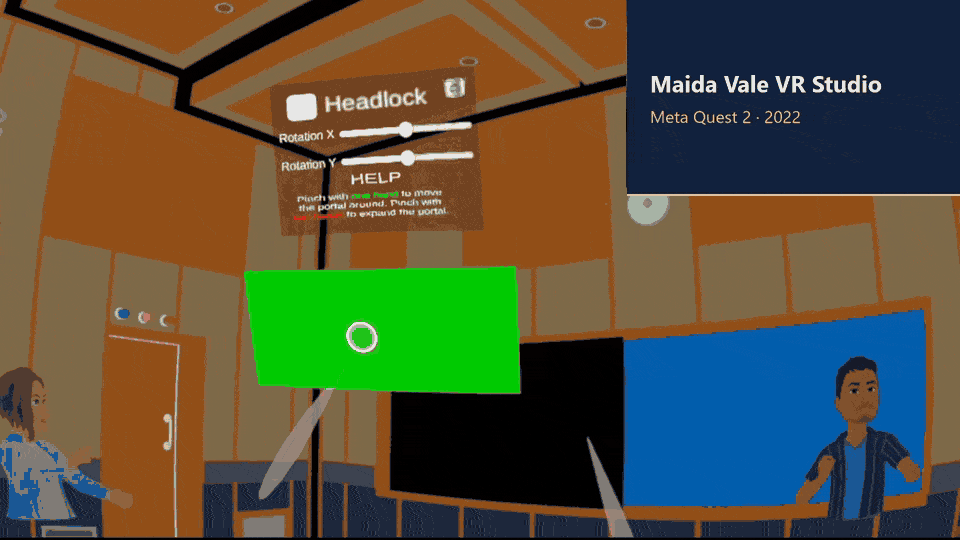

[English](README.md) · **Français**

# Maida Vale VR Studio

**Des musiciens dans des pièces séparées jouent ensemble en réalité virtuelle, en avatars, dans une copie du Studio 4 de la BBC à Maida Vale, et entendent son acoustique mesurée.** Recherche doctorale à l'AudioLab de l'université d'York, avec BBC R&D.

*Dans le casque : le studio, les avatars des autres musiciens, un portail passthrough (vert : déplacé d'une main, rouge : agrandi des deux). Version antérieure sur Meta Quest 2, 2022. [Vidéo complète (1:08)](https://drive.google.com/file/d/1bTghQBJOkCSHszd59ZwPXW41YPoqc6p8/view)*

## Utilisation

- **Avatars.** Chaque musicien apparaît en avatar Meta, animé par la tête, les mains et le corps. Sur Quest Pro, le suivi du visage et des yeux anime son expression et son regard.
- **Portail passthrough.** Une fenêtre sur la pièce réelle, pour voir son propre instrument. Pincer d'une main pour la déplacer, des deux mains pour l'agrandir.
- **Instruments.** Chaque musicien choisit piano, guitare ou voix ; un piano ou une guitare apparaît dans le studio.
- **Son du studio.** Chaque musicien entend le groupe dans le Studio 4, rendu pour sa place, et le son tourne avec sa tête.
- **Conduite de l'essai.** Le PC de régie fige la scène, place caméra, instrument et portail, active ou coupe visage et corps, et note chaque prise. Chaque casque enregistre sa latence et ses images par seconde.

## Architecture

Diagramme en français

## État

- **Recherche.** Utilisé pour une session d'enregistrement d'un groupe en direct ([JAES, 2023](https://eprints.whiterose.ac.uk/206403/)) et une étude de quatre styles d'avatar avec un groupe de rock de quatre musiciens ([AES, 2023](https://www.aes.org/e-lib/browse.cfm?elib=22183)).
- **Réseau.** Données d'avatar en OSC sur un réseau local ; audio entre les pièces par JackTrip.
- **Son.** Reaper avec encodage ambiX, convolution X-MCFX par des réponses impulsionnelles ambisoniques d'ordre 3 mesurées dans le Studio 4, IEM SceneRotator et décodage binaural.
- **Technos.** Unity, Meta XR SDK, Meta Avatars SDK, Interaction SDK, extOSC ; Meta Quest 2, puis Quest Pro.
- **Aujourd'hui.** Prototype du doctorat, qui n'est plus développé.

---

**Anthony Hunt** · [ingevision.cloud](https://ingevision.cloud/?lang=fr&p=maida-vale) · [LinkedIn](https://www.linkedin.com/in/anthony-hunt-3948a9196) · [GitHub](https://github.com/anthohunt)

Le code est privé ; ce dépôt le présente.
