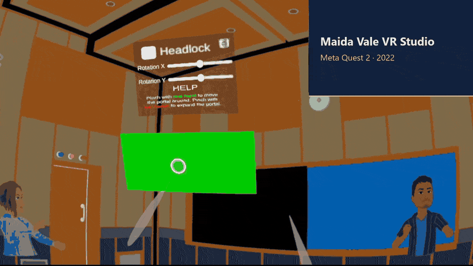

**English** · [Français](README.fr.md)

# Maida Vale VR Studio

**Musicians in separate rooms play together in VR, as avatars inside a virtual copy of Studio 4 at BBC Maida Vale, and hear its measured acoustics.** PhD research at the University of York AudioLab with BBC R&D.

*Inside the headset: the studio, the other musicians' avatars, a passthrough portal (green: moved with one hand, red: stretched with two). Earlier version on Meta Quest 2, 2022. [Full video (1:08)](https://drive.google.com/file/d/1bTghQBJOkCSHszd59ZwPXW41YPoqc6p8/view)*

## Using it

- **Avatars.** Each musician appears as a Meta avatar driven by head, hands and body. On Quest Pro, face and eye tracking drive its expression and gaze.
- **Passthrough portal.** A window onto the real room, to see one's own instrument. Pinch with one hand to move it, with two hands to stretch it.
- **Instruments.** Each musician picks piano, guitar or voice; a piano or guitar model appears in the studio.
- **Studio sound.** Every musician hears the band in Studio 4, rendered for their seat, and the sound turns with their head.
- **Experiment control.** The control PC freezes the scene, places camera, instrument and portal, switches face or body on and off, and logs each take. Each headset records its latency and frame rate.

## Architecture

## Status

- **Research.** Used for a live band recording session ([JAES, 2023](https://eprints.whiterose.ac.uk/206403/)) and a study of four avatar styles with a four-piece rock band ([AES, 2023](https://www.aes.org/e-lib/browse.cfm?elib=22183)).
- **Network.** Avatar data over OSC on a local network; audio between rooms over JackTrip.
- **Sound.** Reaper with ambiX encoding, X-MCFX convolution of third-order Ambisonic impulse responses measured in Studio 4, IEM SceneRotator and binaural decoding.
- **Stack.** Unity, Meta XR SDK, Meta Avatars SDK, Interaction SDK, extOSC; Meta Quest 2, then Quest Pro.
- **Today.** Prototype from the PhD, no longer developed.

---

**Anthony Hunt** · [ingevision.cloud](https://ingevision.cloud/?lang=en&p=maida-vale) · [LinkedIn](https://www.linkedin.com/in/anthony-hunt-3948a9196) · [GitHub](https://github.com/anthohunt)

The code is private; this repository presents it.
